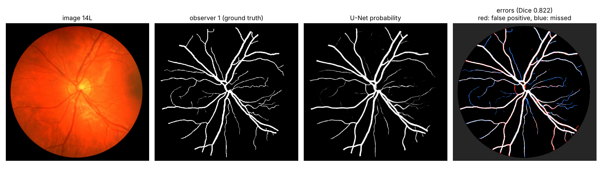
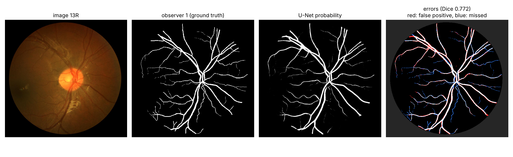
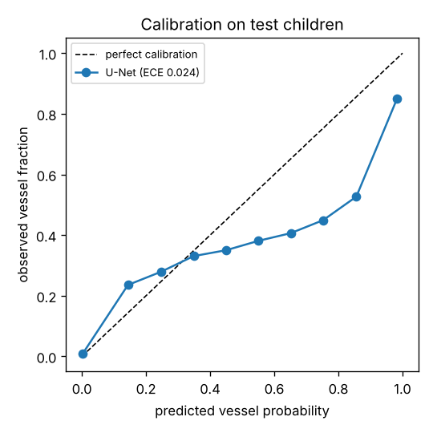

# Retinal vessel segmentation with a small U-Net

A compact PyTorch U-Net that segments blood vessels in colour fundus photographs from the public [CHASE_DB1](https://researchinnovation.kingston.ac.uk/en/datasets/chasedb1-retinal-vessel-reference-dataset-4/) dataset. It trains in about 13 minutes on a 2-core CPU, no GPU needed.

The point of the project is less the architecture than the evaluation: a split by child (not by image), a threshold chosen on validation data only, a comparison with a second human annotator, calibration, and a look at where the model goes wrong.

## Results (8 test images from 4 children the model never saw)

| | Dice | Sensitivity | Specificity | AUC |
|---|---|---|---|---|
| U-Net (threshold 0.6, chosen on validation) | 0.797 ± 0.014 | 0.820 | 0.976 | 0.982 |
| Second human observer vs first | 0.798 ± 0.015 | | | |

All metrics are computed inside the field of view, against the first observer's annotation, at half resolution (480 × 500 pixels). On these children the model agrees with the first annotator about as well as the second annotator does. Per-image numbers are written to `runs/unet/test_results.json`.




**Where it goes wrong.** Red pixels are false positives, blue are missed vessels. The model draws the large vessels slightly too wide (red edges) and misses many of the thinnest capillaries (blue), which are only one or two pixels wide at this resolution. Working at full resolution, or with a loss that weights thin vessels, would be the next things to try.

**Calibration.** The expected calibration error is low (0.024), but that number is dominated by the many background pixels that are confidently and correctly near 0. The reliability curve shows that pixels predicted at 0.6-0.9 are vessels only about 40-55 % of the time, so the probabilities in that range are over-confident. Thresholded masks are fine; the raw probabilities should not be read as calibrated without a correction step such as temperature scaling.



## Method

- **Data:** 28 images of 14 children (left and right eye), each with vessel annotations from two observers. Images are downscaled by 2.
- **Split by child:** children 1-8 for training (16 images), 9-10 for validation (4 images), 11-14 for testing (8 images). Both eyes of a child are always in the same split, so the test set measures generalisation to new people.
- **Pre-processing:** per-image standardisation of the RGB channels; the field-of-view mask is obtained by thresholding the red channel, since CHASE_DB1 does not include one.
- **Model:** U-Net with 3 down-sampling levels and 16-128 channels (0.48 M parameters), batch norm, transposed-convolution up-sampling.
- **Training:** random 128 × 128 patches with rotations and flips, batch size 8, BCE + soft Dice loss, Adam (learning rate 1e-3, cosine decay), 4,000 iterations. The checkpoint with the best validation Dice is kept.
- **Threshold:** chosen on the validation children (grid 0.2-0.8), never on the test set.

## Run it

```bash
pip install -r requirements.txt
# download CHASEDB1.zip from the dataset page linked above and unzip it into data/CHASEDB1/
python train.py --data data/CHASEDB1          # about 13 min on a 2-core CPU
python evaluate.py --data data/CHASEDB1       # prints the table and writes figures/
```

## Files

| File | Purpose |
|---|---|
| `src/data.py` | loading, field-of-view mask, split by child |
| `src/model.py` | the U-Net |
| `src/metrics.py` | Dice, sensitivity, specificity, AUC, calibration |
| `src/predict.py` | whole-image inference with padding |
| `train.py` | patch-based training with validation checkpointing |
| `evaluate.py` | test metrics, second-observer comparison, figures |

## Data and citation

CHASE_DB1 is published by Kingston University under CC BY 4.0. The images are not included in this repository; the figures above show test images with the model's output. Please cite:

M. M. Fraz, P. Remagnino, A. Hoppe, B. Uyyanonvara, A. R. Rudnicka, C. G. Owen and S. A. Barman, "An ensemble classification-based approach applied to retinal blood vessel segmentation," *IEEE Transactions on Biomedical Engineering* 59(9), 2538-2548 (2012).

## Author

Asieh Daneshi, PhD · Berlin · [LinkedIn](https://www.linkedin.com/in/asieh-daneshi)
